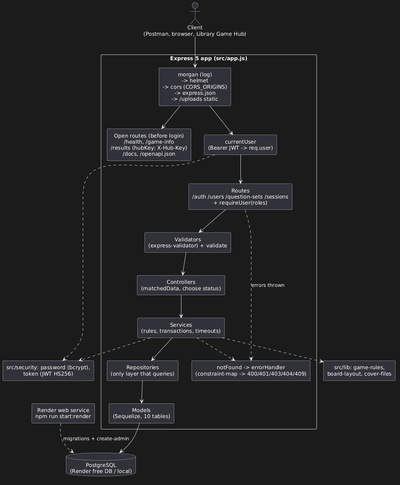
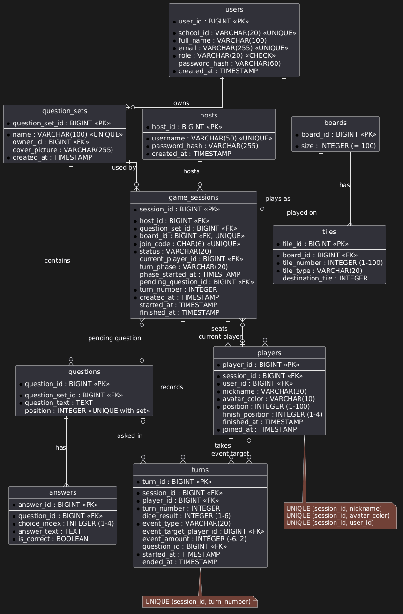

# Technical specification: QuizLadder API

Version 1.6.0, SE1 final build. Developer: Joenilo F. Estillero (joyboyy23), BSCS 3-1. Group: Team 8.

## 1. Purpose and scope

QuizLadder is a multiplayer Snake and Ladder quiz game for 2 to 4 players at the SorSU Bulan Campus library. Students play the game. HOST or ADMIN accounts host sessions and manage question sets. The Library Game Hub reads finished games from GET /results using the X-Hub-Key header. SE1 covers the backend API. SE2 will add the frontend.

## 2. Architecture

One request runs through helmet, then cors, then express.json, then the routes. currentUser reads the Bearer token. requireUser checks the role. The validator and validate check the input. The controller calls one service. The service uses a repository and a model to talk to the database. Errors go to the error handler, which uses the constraint map.

| Layer | Folder | Responsibility | Never |
|---|---|---|---|
| Routes | `src/routes` | Connect a URL to its guards and validators. | Never hold game rules. |
| Validators | `src/validators` | Check the shape of the input. | Never talk to the database. |
| Controllers | `src/controllers` | Read the checked input, call one service, choose the status code. | Never hold rules or SQL. |
| Services | `src/services` | Hold the rules and transactions. | Never use req or res, and never write queries. |
| Repositories | `src/repositories` | The only place that talks to the database. | Never hold rules. |
| Models | `src/models` | Describe one table each. | Never hold rules or call services. |

## 3. Data

There are 10 tables. See [data-dictionary.md](data-dictionary.md).

| Table | What it holds |
|---|---|
| `users` | Library accounts with a role and a password hash |
| `hosts` | The service host row that every game is linked to |
| `question_sets` | Named groups of questions, with an owner and an optional cover |
| `questions` | One question in a set, in a fixed position |
| `answers` | The four choices of a question, one marked correct |
| `boards` | One 100-tile board for each game |
| `tiles` | The 100 tiles of a board: normal, event, snake or ladder |
| `game_sessions` | A game: join code, status, current player and turn phase |
| `players` | A seat in a game: nickname, color, board position and finish order |
| `turns` | A record of each turn: dice, event, target and amount |

The database enforces UNIQUE, CHECK, and foreign-key rules by itself. Broken UNIQUE or foreign-key rules become codes in `src/errors/constraint-map.js`: taken school ID, taken email, taken set name, question position conflict, taken nickname, taken avatar color, and question set in use. CHECK rules keep board position from 1 to 100, allow only the avatar colors, status values, dice from 1 to 6, and event amount from -6 to 2. Foreign keys use ON DELETE RESTRICT so linked rows cannot be removed while still referenced.

## 4. Security

| Concern | Decision |
|---|---|
| Passwords | bcrypt, 8 to 72 characters, with a letter and a number. The hash is never returned by the API. |
| Login and tokens | JWT signed with HS256, expires in 1 hour. The account is read from the database on every request. A wrong password and an unknown school ID give the same 401 answer. |
| Roles | PLAYER, HOST, ADMIN, checked by requireUser before validation. A new account is always a PLAYER. An admin cannot change their own role. |
| Input | express-validator on every route, only allowed sort columns, search text is escaped, Sequelize uses safe queries, covers must be PNG or JPEG up to 1 MB with a name the server chooses. |
| Your game's trust boundary | The server rolls the dice, picks the question, measures the time limits and moves the players. The client only sends the choice, the target and the amount. is_correct is never sent. The test-only dice and event fields are ignored in production. |
| Browsers (CORS) | Only origins listed in CORS_ORIGINS are allowed, and helmet adds safe headers. CORS does not protect /results because curl and Postman ignore it. |
| The Hub | /results needs the X-Hub-Key header, compared in a safe way. Results are never public. |

## 5. Quality

There are Jest unit tests that use jest.mock, and HTTP tests that use supertest. There is a Postman collection in postman/. An automatic check (lines A to O) runs on GitHub.
Numbers: Jest runs 123 tests in 17 files, and all of them pass. They cover 96.23% of the lines in src. The tests include unit tests with jest.mock and HTTP tests with supertest. The Postman collection has 163 requests and 324 tests, and all of them pass on a fresh database. The automatic check (lines A to O) runs on GitHub after every push.

## 6. Deployment

Render web service named quizladder-joyboyy23 and a free PostgreSQL database, both in Singapore. Start command: npm run start:render (runs migrations, creates the first admin, starts the API). Live address: https://quizladder-joyboyy23.onrender.com/api/v1. Free plan limits: the service sleeps after 15 minutes and takes about a minute to wake, the database expires 30 days after it was created (December 21, 2026), and there is no persistent disk so uploaded covers disappear on restart.

## 7. Decisions and their reasons

| Decision | Reason | Alternative not taken |
|---|---|---|
| Timeouts are applied lazily when someone calls the API, under a row lock on the game session. | The game stays consistent without a worker. Cost: the game only moves forward when a request arrives. | Background timers. |
| The server owns the dice and the clock, with test-only overrides outside production. | Clients cannot cheat the roll or the timer. Cost: one extra code path for tests. | Trust the client. |
| Rank by finish_position, not score. | Matches the finish-order contract. Cost: every finisher scores 100. | Points-based scoring. |
| A returning player gets their seat back before any status check. | Players never lose a seat they already hold. Cost: seats in finished games stay. | Block rejoin on finished games. |
| One shared "librarian" host row created on demand. | Sessions still need a host_id without a separate host login. Cost: all games share one host_id. | Link games to the user who created them. |
| Roles renamed to PLAYER, HOST, ADMIN. | The check needs new accounts to be PLAYER. Cost: one migration that converts old rows. | Keep STUDENT, FACULTY, STAFF. |
| A question set used by a game is frozen. | Played games keep their questions. Cost: a typo in a used set cannot be fixed. | Versioned questions. |
